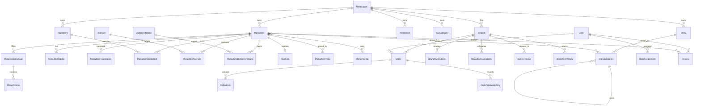

# Mesob House — Architecture Rebuild

**Milestone 1 — Audit and design**
**Status:** Approved for implementation; database reset still gated on local-target confirmation
**Date:** 2026-11-05

This document is the design gate required by the new specification. It is the
implementation contract for the rebuild.

---

## 0. Source hierarchy and conflict resolution

Two documents were supplied. They overlap, but they do not agree on every
point. This design uses the following precedence:

1. **`Mesob House — Menu Management Upgrade Spec.md`** — the corrective
   architecture source of truth. It wins wherever the two documents conflict.
2. **`Task: Upgrade Restaurant Menu Management to a World-Class, Production-Ready Architecture`**
   (the “Task” document) — the expanded database field inventory and
   implementation checklist. It is authoritative where it adds requirements
   that do not conflict with the Upgrade Spec.

### Conflicts resolved in favor of the Upgrade Spec

| Topic | Task document says | Upgrade Spec says | This design uses |
|---|---|---|---|
| Existing data | Preserve records, avoid destructive migration | Database is rebuilt from scratch; no valuable data | **Reset the local database from one clean baseline.** No backfill or compatibility layer. Stable slugs are reused where they still fit. |
| Retail fields | Add `brand`, `manufacturer`, `barcode`, `longDescription` | Skip retail-style fields (`brand`, `manufacturer`, `barcode`, `longDescription`) | **Omit those fields.** Marketing copy goes in `description` or translations. |
| Category link | `MenuItem.categoryId` | A dish can belong to categories in one or more menus; use a join table | **`MenuItemCategory` join table.** |
| Inventory stock | `InventoryItem.currentStock` | Stock is branch-scoped; `BranchInventory` holds stock | **`InventoryItem` definition + `BranchInventory` per-branch stock.** |
| API compatibility | Keep existing APIs working or provide a migration plan | No old columns or old API shapes for backward compatibility | **Replace API shapes and update UI/tests in the same milestone.** |
| Branch pricing | `MenuItemPrice` and `BranchMenuItem.priceOverride` | Both are listed, but effective price has one resolver | **`MenuItemPrice` is the single price source; no duplicate `priceOverride`.** |
| Branch naming | `RestaurantBranch` | `Branch` | **`Branch`.** |
| Tenancy | Multi-restaurant compatible | One restaurant business with one or many branches; no marketplace | **`Restaurant` + `Branch` schema; one restaurant seeded; no vendor features.** |

The pasted Task document is therefore not discarded. Its extra field inventory
is incorporated where it does not contradict the corrective spec.

---

## 0.1 Change control for this milestone

**What changes now**

- Updates this design document to reconcile both source documents.
- Adds no runtime code, schema, migration, or database change.

**What does not change now**

- No Prisma schema changes.
- No migration files are deleted or created.
- No database is reset, migrated, or seeded.
- No runtime code is rewritten.
- No remote database is touched.

**Files affected now**

- `docs/ARCHITECTURE_REBUILD.md`.

**What can break now**

- Nothing at runtime. This is documentation.

**Next milestone gate**

- Milestone 2 may start after the local database target is confirmed.
- The reset itself still requires the local-target check and a local dump.

---

## 1. Confirmed decisions

| # | Decision | Implementation consequence |
|---|---|---|
| 1 | Ethiopian tax context; tax is inclusive by default | Tax categories and effective-dated rates are data, not constants. Default VAT is inclusive and configurable. |
| 2 | ETB only for now; design must allow future currencies; rounding is per order | Money is stored as integer santim; currency is stored explicitly; rounding happens once on the order total calculation. |
| 3 | Admin enters the service charge and selects whether it is taxable | Service charge is branch-level configuration with an amount/rate and a taxable flag. It is snapshotted on the order. |
| 4 | Promotions can be restaurant-wide or branch-level; no stacking | Promotion scope is modelled explicitly. An order can redeem at most one promotion. |
| 5 | Delivery is dynamic; admin defines zones, base fees and minimum orders; pickup is supported; status is visible to delivery staff, admin and customer | Delivery zones, fees and minimums are branch data. Delivery staff get a scoped order view. Pickup remains a fulfillment type. |
| 6 | Admin owns allergen confirmation; unreviewed dishes must not be presented as allergen-free | Public DTOs return `allergenStatus: CONFIRMED` only when there is confirmed data; otherwise `NOT_CONFIRMED`. No dish is labelled “allergen-free” by absence of rows. Current allergen strings are seeded as unconfirmed candidates. |
| 7 | Seed the current menu; restructure it where the new model requires it; use a new sample only if the current data cannot be mapped; 1 branch | Current dishes, categories, media, options and pairings are mapped into the new model. One default branch is seeded. |
| 8 | TypeScript only for database-related/backend code | `src/lib`, server actions, repository/service/policy code and API routes become TypeScript. Existing JSX components remain JavaScript/JSX unless they need a type-only import change. |

### Decision 6 interpretation

“Admin, none, no allergens” is interpreted as:

- The admin is the only role that can confirm allergen data.
- A dish with no confirmed allergen records displays **“Allergen information not confirmed”**.
- A dish is never displayed as **“allergen-free”** merely because it has no rows.
- Seeded allergen strings from the current catalogue may be imported as
  **unconfirmed candidates**, so the admin can review and confirm them. If a
  dish has no candidates, it still has no confirmed claim.

This interpretation is approved and recorded as an implementation rule.

---

## 2. Current code audit

### 2.1 What the current app does

The app is a production-shaped single-restaurant Next.js 16 storefront and
operations portal, currently backed by PostgreSQL through Prisma 7 and a
custom SQL migration runner.

**Customer-facing features**

- Marketing home page with specials and ISR.
- Public menu with categories, search and dish cards.
- Dish pages with options, pairings, ratings, verified reviews and metadata.
- Browser-local cart with persisted Zustand state.
- Checkout for delivery or pickup with contact details, payment-method UI and
  server-authoritative order placement.
- Customer accounts, sessions and order history.
- Live order status through polling and an authenticated SSE stream.
- Leaflet delivery map with illustrative courier position.
- CSV export of order history.
- Static terms, privacy, sitemap, robots, manifest and Open Graph cards.

**Staff features**

- Role-aware sign-in and route gate.
- Kitchen queue with order status transitions and charts.
- Admin dashboard with revenue, order, customer and dish charts.
- Admin order list and status control.
- Admin menu editor for dishes, option groups, options and pairings.
- Admin review moderation.
- Admin user-role management.
- Audit rows for menu changes.
- Verified-review database trigger.

**Current routes**

- Public: `/`, `/menu`, `/dish/[slug]`, `/cart`, `/terms`, `/privacy`,
  `/sign-in`, `/register`.
- Customer: `/account`, `/checkout`, `/orders`, `/orders/[id]`.
- Staff: `/kitchen`, `/admin`, `/admin/orders`, `/admin/menu`,
  `/admin/reviews`, `/admin/users`.
- API: session, menu, menu search, menu specials, orders, order detail,
  order cancel, order SSE, kitchen orders, admin stats, admin orders, admin
  menu, admin reviews, admin users, health, revalidate.

**Current data model**

- `users`, `sessions`.
- `menu_categories`, `menu_items`, `menu_option_groups`, `menu_options`,
  `menu_pairings`.
- `reviews`.
- `orders`, `order_items`, `order_status_history`.
- `audit_log`.
- SQL migrations `001`–`005`, including triggers, generated totals, partial
  indexes, check constraints and verified-review enforcement.
- Operational scripts for migration, import, reconciliation, load testing,
  security checks, backup/restore and EXPLAIN.

### 2.2 What is worth reusing

- The UI system, layout, components and styles.
- Authentication primitives: opaque session cookie, hashed token storage,
  scrypt password hashes, session revocation.
- The order status progression and kitchen/admin transition pattern.
- SSE order tracking, SWR polling and CSV export.
- The verified-review UI and purchase-eligibility rule.
- The Leaflet map component, adapted to branch delivery zones.
- The catalogue content itself: 25 active dishes, 6 categories, images,
  descriptions, option groups, pairings and tags.
- The custom migration/DB script safety guard against remote writes.
- Existing CI and security/load test habits.

### 2.3 What must be replaced

- The Prisma schema and all five current migrations.
- `src/lib/menu.js`, `orders.js`, `pricing.js`, `adminMenu.js`, `reviews.js`,
  `db.js`, `analytics.js`, `deliveryMap.js`, `roles.js`, `schemas.js`.
- All API route handlers and server actions that touch the database.
- The admin menu editor, which currently assumes one flat dish object with
  nested option groups and a single image URL.
- The cart/checkout pricing path, which uses JavaScript floating-point money.
- The three-role model (`customer`, `employee`, `admin`) and ad-hoc role checks.
- The fixed Addis sub-city list and static delivery map areas.
- The legacy import/reconciliation assumptions tied to the old schema.
- The current custom migration history.

### 2.4 Current risks to carry into the rebuild

- A full database reset destroys all local orders, sessions and menu edits.
- The frontend will need DTO updates in the same milestone as each API change.
- The admin menu editor is the largest UI rewrite.
- Moving to TypeScript at the database boundary while leaving JSX components in
  place requires strict import boundaries and no `any` leakage.
- The current date/time handling is mostly Addis-specific; the new model must
  evaluate schedules in the branch timezone, not the server timezone.
- The current pricing function uses floats; this must be replaced before any
  order writes are re-enabled.
- The current role gate is route-based and not a central policy layer.

---

## 3. Target architecture

### 3.1 Principles

1. **One restaurant, one or many branches.** `restaurantId` is ownership, not a
   query-time tenant boundary. Branch data is scoped by branch policy.
2. **Catalog is restaurant-level.** Branches layer availability, price and
   preparation overrides only.
3. **One effective-price/availability resolver.** Menu API, cart validation and
   order placement call the same server-side function.
4. **Money is exact.** Integer minor units, server-calculated totals, no
   client-supplied prices.
5. **Snapshots are immutable.** Orders never recompute historical lines from
   the live menu.
6. **One policy layer.** Every branch-scoped repository/service asks the policy
   layer for permitted actions and branch IDs.
7. **Soft-delete catalog rows.** Historical receipts and audit history remain
   valid.
8. **SQL owns invariants Prisma cannot express.** Partial indexes, checks,
   generated totals, overlap protection and purchase-integrity triggers.
9. **No marketplace features.** No vendors, commissions or per-vendor payouts.
10. **Multi-restaurant-compatible, single-restaurant-operated.** The schema
    carries `restaurantId`; the product does not expose tenant/marketplace
    onboarding.
11. **Multi-currency and multi-language by schema.** Currency is explicit on
    money-bearing rows; translations are first-class; ETB/English is the seeded
    default.
12. **Separate staff roles from customers.** Branch-scoped role assignments and
    a central policy layer replace the old three-role model.

### 3.2 High-level domain diagram



### 3.3 Enums

Names are indicative; exact DB enum names will be finalized in the baseline
migration.

- `AccountType`: `CUSTOMER`, `STAFF`
- `StaffRole`: `RESTAURANT_OWNER`, `SUPER_ADMIN`, `RESTAURANT_MANAGER`,
  `BRANCH_MANAGER`, `CASHIER`, `KITCHEN_STAFF`, `INVENTORY_MANAGER`,
  `DELIVERY_STAFF`
- `RestaurantStatus`: `ACTIVE`, `INACTIVE`, `SUSPENDED`
- `BranchStatus`: `ACTIVE`, `INACTIVE`
- `MenuType`: `ALL_DAY`, `BREAKFAST`, `LUNCH`, `DINNER`, `DRINKS`,
  `DESSERTS`, `SEASONAL`, `SPECIAL`
- `ServingTemperature`: `HOT`, `COLD`, `ROOM_TEMPERATURE`
- `DifficultyLevel`: `EASY`, `MEDIUM`, `HARD`
- `SpiceLevel`: `NONE`, `MILD`, `MEDIUM`, `HOT`, `EXTRA_HOT`
- `Unit`: `G`, `KG`, `ML`, `L`, `PIECE`, `TBSP`, `TSP`, `CUP`, `PORTION`
- `MediaType`: `IMAGE`, `VIDEO`
- `AllergenSource`: `INGREDIENT`, `CROSS_CONTACT`
- `VerificationStatus`: `UNVERIFIED`, `VERIFIED`, `REJECTED`
- `NutritionSource`: `LAB_TESTED`, `CALCULATED`, `MANUFACTURER`, `ESTIMATED`
- `PairingType`: `RECOMMENDED`, `DRINK`, `SIDE`, `DESSERT`, `RELATED`
- `SelectionType`: `SINGLE`, `MULTIPLE`
- `DisplayType`: `RADIO`, `CHECKBOX`, `DROPDOWN`, `BUTTON`
- `AvailabilityStatus`: `AVAILABLE`, `OUT_OF_STOCK`, `TEMPORARILY_UNAVAILABLE`,
  `DISCONTINUED`
- `ServiceChargeType`: `NONE`, `PERCENTAGE`, `FIXED`
- `PromotionScope`: `RESTAURANT`, `BRANCH`
- `PromotionType`: `PERCENTAGE`, `FIXED`
- `OrderStatus`: `RECEIVED`, `PREPARING`, `READY`, `OUT_FOR_DELIVERY`,
  `COMPLETED`, `CANCELLED`
- `FulfillmentType`: `DELIVERY`, `PICKUP`
- `PaymentStatus`: `PENDING`, `PAID`, `REFUNDED`, `CANCELLED`
- `ReviewStatus`: `PENDING`, `APPROVED`, `REJECTED`
- `InventoryTransactionType`: `PURCHASE`, `DEDUCTION`, `ADJUSTMENT`,
  `TRANSFER_OUT`, `TRANSFER_IN`
- `TransferStatus`: `DRAFT`, `IN_TRANSIT`, `COMPLETED`, `CANCELLED`

### 3.4 Identity, tenancy and authorization

**`Restaurant`**

- `id`, `name`, `slug` (unique), `legalName`, `description`, `logoUrl`,
  phone/email/address.
- `timezone` default `Africa/Addis_Ababa`.
- `defaultLocale` default `en`.
- `defaultCurrency` `char(3)` default `ETB`.
- `defaultTaxInclusive` default `true`.
- `status` (`RestaurantStatus`), timestamps.
- The schema is multi-restaurant compatible even though one restaurant is
  seeded. There is no marketplace/vendor layer.

**`Branch`**

- `id`, `restaurantId`, `name`, `slug`, address, latitude/longitude, phone.
- `timezone`; inherits restaurant default when blank.
- `status` (`ACTIVE`/`INACTIVE`).
- `isDefault`; partial unique index allows at most one default branch per
  restaurant.
- Service charge: `serviceChargeType`, `serviceChargeValue`,
  `serviceChargeTaxable`.
  - `PERCENTAGE`: basis points (`1000` = 10%).
  - `FIXED`: minor units.
  - `NONE`: value must be `0`.
- Timestamps.
- Unique `(restaurantId, slug)`.
- A restaurant with no branches auto-creates one default branch in the seed and
  in the branch-creation service.

**`BranchOperatingHours`**

- `id`, `branchId`, `dayOfWeek` (0–6), `opensAt`, `closesAt`, `isClosed`.
- Supports multiple windows per day (for example lunch and dinner).
- Evaluated in the branch timezone.

**`User`**

- `id`, `fullName`, email, phone, password hash, provider, preference.
- `accountType` (`CUSTOMER`/`STAFF`).
- Timestamps.
- Customers have no staff role assignment; staff have one or more.

**`RoleAssignment`**

- `id`, `userId`, `role`, `restaurantId`, `branchId` nullable.
- Restaurant-level assignment: `branchId = null`.
- Branch-level assignment: `branchId` set and must belong to `restaurantId`.
- Unique `(userId, role, restaurantId, branchId)`.
- Central policy layer resolves the union of roles and permitted branch IDs.

**`Session`**

- Keep the current opaque-token session model: hashed token, expiry,
  revocation, user agent and IP metadata.

### 3.5 Catalog

**`Menu`**

- `id`, `restaurantId`, `name`, `slug`, `description`, `type`, `isActive`,
  `validFrom`, `validUntil`, `sortOrder`.
- Unique `(restaurantId, slug)`.

**`MenuCategory`**

- `id`, `menuId`, `parentId`, `name`, `slug`, `description`, `imageUrl`,
  `sortOrder`, `isActive`.
- Unique `(menuId, slug)`.
- Parent must be in the same menu; validated by the service and a SQL trigger.
- Nested categories are supported.

**`MenuItem`**

- `id` (UUID), `restaurantId`, `sku` nullable, `slug`, `name`, `nativeName`,
  `shortDescription`, `description`, `searchKeywords`.
- `sortOrder`, `spiceLevel`, `spiceNotes`, `isSpecial`.
- `preparationTimeMinutes`, `cookingTimeMinutes`, `preparationMethods`,
  `preparationNotes`.
- `servingSize` decimal, `servingUnit`, `servingTemperature`, `servingNotes`,
  `difficultyLevel`.
- `basePriceMinor`, `currency`, `compareAtPriceMinor`, `costPriceMinor`.
- `taxCategoryId`, `isTaxInclusive`, `serviceChargeApplicable`.
- `badgeText`, `badgeTone` (presentation metadata retained from the current UI).
- `deletedAt` soft delete, timestamps.
- Unique `(restaurantId, slug)`.
- Partial unique index on `(restaurantId, sku)` where `sku IS NOT NULL`.
- SKU, `basePriceMinor`, `compareAtPriceMinor` and `costPriceMinor` cannot be
  negative; `compareAtPriceMinor >= basePriceMinor` when present.
- `costPriceMinor` is never returned by public DTOs.
- Retail-only Task fields (`brand`, `manufacturer`, `barcode`, `longDescription`)
  are intentionally omitted per the Upgrade Spec. Long marketing copy belongs
  in `description` or a translation.

**`MenuItemTranslation`**

- `id`, `menuItemId`, `locale`, `name`, `shortDescription`, `description`,
  `nativeName`.
- Unique `(menuItemId, locale)`.
- Falls back to the restaurant default locale.

**`MenuItemCategory`**

- `menuItemId`, `categoryId`, `sortOrder`.
- Primary key `(menuItemId, categoryId)`.
- A dish may be in categories in one or more menus.

**`Ingredient`**

- `id`, `restaurantId`, `name`, `slug`, `description`, `defaultUnit`,
  `isActive`, timestamps.
- Unique `(restaurantId, slug)`.

**`MenuItemIngredient`**

- `id`, `menuItemId`, `ingredientId`, `quantity` nullable decimal, `unit`,
  `isOptional`, `isSubstitutable`, `preparationNote`, `sortOrder`.
- Unique `(menuItemId, ingredientId)`.
- Quantity is nullable only to support legacy catalogue import without invented
  weights; the admin should fill it during enrichment.

**`Allergen`**

- `id`, `code` unique, `name`, `description`.
- Seeded with the 14 standard allergens: milk, eggs, peanuts, tree nuts,
  soybeans, cereals containing gluten, fish, crustaceans, molluscs, sesame,
  mustard, celery, lupin, sulphites.

**`MenuItemAllergen`**

- `id`, `menuItemId`, `allergenId`, `source` (`INGREDIENT`/`CROSS_CONTACT`),
  `isConfirmed`, `notes`.
- Unique `(menuItemId, allergenId, source)`.
- Removing an ingredient does not delete allergen rows.
- Only authorized roles may write; every change is audited.
- Public `allergenStatus` is `CONFIRMED` only when at least one confirmed row
  exists; otherwise `NOT_CONFIRMED`.

**`DietaryAttribute`**

- `id`, `code` unique, `name`, `description`.
- Seeded codes: `VEGETARIAN`, `VEGAN`, `PESCATARIAN`, `GLUTEN_FREE`,
  `DAIRY_FREE`, `HALAL`, `KOSHER`, `KETO`, `LOW_CARB`, `LOW_SODIUM`, `FASTING`.

**`MenuItemDietaryAttribute`**

- `id`, `menuItemId`, `dietaryAttributeId`, `verificationStatus`,
  `verifiedAt`, `verifiedBy`.
- Unique `(menuItemId, dietaryAttributeId)`.
- Public API exposes only `VERIFIED` claims.
- `FASTING` is explicitly set and verified; it is never inferred from `VEGAN`
  or from ingredients.

**`Nutrition`**

- `id`, `menuItemId` unique.
- `servingSize`, `servingUnit`.
- `caloriesKcal`, `energyKj`.
- `proteinG`, `carbohydratesG`, `sugarsG`, `addedSugarsG`.
- `totalFatG`, `saturatedFatG`, `transFatG`, `fiberG`.
- `sodiumMg`, `cholesterolMg`.
- `nutritionSource`, `nutritionVerifiedAt`, `verifiedBy`, timestamps.
- All numeric values non-negative.
- Public DTO always includes `nutritionSource`; `ESTIMATED` is never rendered as
  lab-tested.
- Future vitamins/minerals will use a child table, not a JSON blob.

**`MenuItemMedia`**

- `id`, `menuItemId`, `url`, `altText`, `mediaType`, `width`, `height`,
  `isPrimary`, `sortOrder`, `createdAt`.
- URLs only; files live in object storage or an image CDN.
- Partial unique index: at most one primary image per dish.
- No single `imageUrl` column on `MenuItem`.

**`MenuPairing`**

- `id`, `menuItemId`, `pairedMenuItemId`, `type`, `sortOrder`.
- Unique `(menuItemId, pairedMenuItemId)`.
- Check constraint: `menuItemId <> pairedMenuItemId`.

### 3.6 Pricing, tax and service charge

**`MenuItemPrice`**

- `id`, `menuItemId`, `branchId` nullable, `priceMinor`, `currency`,
  `compareAtPriceMinor`, `validFrom`, `validUntil`, `createdAt`, `createdBy`.
- Branch-specific, scheduled and promotional price history.
- Rows are closed by setting `validUntil`; they are not overwritten.
- A null `branchId` row is a catalog-wide scheduled price.
- Effective price resolver chooses the most specific active row for the branch
  and instant, then falls back to `MenuItem.basePriceMinor`.
- No implicit FX conversion. A price row carries its currency; a future
  multi-currency checkout must choose an explicit price row in the order
  currency.

**Approved design deviation:** section 4 of the spec also lists
`BranchMenuItem.priceOverride`. To avoid two conflicting price sources, this
design uses `MenuItemPrice` as the single price-history source and omits a
duplicate `priceOverride` column. The approved rule preserves the spec’s intent
while removing the ambiguity.

**`TaxCategory`**

- `id`, `restaurantId`, `code`, `name`, `description`,
  `isInclusiveDefault`, `isActive`.
- Unique `(restaurantId, code)`.

**`TaxRate`**

- `id`, `taxCategoryId`, `rateBasisPoints`, `validFrom`, `validUntil`,
  `createdAt`, `createdBy`.
- `rateBasisPoints` between `0` and `10000` (15% = `1500`).
- Effective-dated; overlapping ranges are rejected by a database trigger.
- No tax percentage is hardcoded in application code.

**Service charge**

- Branch-level `serviceChargeType`, `serviceChargeValue`, `serviceChargeTaxable`.
- Admin enters the value and toggles taxable.
- Snapshot on the order.

**Promotion**

- `id`, `restaurantId`, `branchId` nullable, `code` nullable, `name`,
  `description`, `scope`, `type`, `value`, `minOrderMinor`,
  `maxDiscountMinor` nullable, `startsAt`, `endsAt`, `isActive`, `priority`.
- Restaurant-wide promotion: `branchId = null`.
- Branch promotion: `branchId` set.
- `code` unique per restaurant when present.
- No stacking: an order has at most one `promotionId`.
- Approved resolution rule: choose the highest-value eligible discount; ties
  break by higher `priority`, then oldest promotion.

**Money and rounding**

- All money columns are integer minor units (santim).
- `defaultCurrency` is stored on the restaurant; `currency` is stored on the
  menu item, each price row and each order.
- No implicit currency conversion. Multi-currency support means a price row can
  be authored in a different currency; the order snapshots the currency used.
- Rounding happens once, on the order total.
- Tax-inclusive: tax portion is `round(taxableBase * rate / (10000 + rate))` for
  inclusive amounts, or `round(base * rate / 10000)` for exclusive.
- Service charge is included in the taxable base only when
  `serviceChargeTaxable` is true.
- No JavaScript floating-point arithmetic is used for money.

### 3.7 Branch layer

**`BranchMenuItem`**

- `branchId`, `menuItemId`, `isEnabled`, `availabilityStatus`,
  `preparationTimeOverride`, `temporaryUnavailableUntil`, timestamps.
- Primary key `(branchId, menuItemId)`.
- Null override means inherit the catalog value.
- Override allow-list: availability, stock status, preparation time, price
  (through `MenuItemPrice`). Everything else is catalog-only.
- Adding a branch creates no menu item rows. Seeding can opt in to all current
  dishes.
- Combined with `MenuItemAvailability`, this is the only source of branch
  availability.

**`MenuItemAvailability`**

- `id`, `branchId`, `menuItemId`, `dayOfWeek` nullable, `availableFrom`,
  `availableUntil`, `isAvailable`, `validFrom`, `validUntil`, `createdAt`.
- Recurring day-of-week windows are evaluated in the branch timezone.
- `isAvailable = false` creates a blackout or temporary unavailability window.
- `validFrom`/`validUntil` support temporary and scheduled changes.
- If the dish has no availability windows, its `BranchMenuItem` status is
  authoritative.
- If it has windows, it is available only inside at least one matching
  `isAvailable = true` window and outside every matching blackout.

**Effective resolver contract**

```ts
resolveBranchMenuItem(branchId, menuItemId, at): {
  menuItemId,
  branchId,
  isAvailable,
  availabilityStatus,
  priceMinor,
  compareAtPriceMinor,
  currency,
  preparationTimeMinutes,
  priceSource: "BASE" | "MENU_ITEM_PRICE",
  availabilitySource: "BRANCH_ITEM" | "SCHEDULE",
}
```

This function is used by:

- the public menu and dish APIs,
- cart validation,
- order placement,
- admin previews.

No route, component or repository may recompute an effective price or
availability independently.

### 3.8 Modifiers

The current catalogue has real duplication: the same heat and injera groups are
repeated across 14 dishes. The new model therefore uses reusable groups.

**`MenuOptionGroup`**

- `id`, `restaurantId`, `key`, `title`, `description`, `isRequired`,
  `selectionType`, `minSelections`, `maxSelections`, `displayType`, `sortOrder`,
  `isActive`, `deletedAt`.
- Unique `(restaurantId, key)`.

**`MenuOption`**

- `id`, `groupId`, `value`, `title`, `description`, `note`, `priceDeltaMinor`,
  `isDefault`, `isActive`, `maxQuantity`, `sortOrder`, `deletedAt`.
- Unique `(groupId, value)`.
- `priceDeltaMinor` can be negative only if a future discount modifier is
  explicitly approved; the first implementation restricts it to non-negative.

**`MenuItemOptionGroup`**

- `id`, `menuItemId`, `groupId`, `sortOrder`.
- Optional overrides: `isRequired`, `minSelections`, `maxSelections`.
- Unique `(menuItemId, groupId)`.

**`BranchMenuOptionAvailability`**

- `branchId`, `optionId`, `isAvailable`.
- Primary key `(branchId, optionId)`.
- Missing row means inherit the option’s catalog `isActive`.

**Modifier invariants**

- Single groups have at most one default.
- Multiple groups have defaults no greater than `maxSelections`.
- Required groups must have a valid selection.
- Inactive options are rejected.
- Group updates diff by stable ID; they never delete and recreate groups.
- Order lines snapshot selected option titles, deltas and totals.

### 3.9 Orders and snapshots

**`Order`**

- `id` UUID, `publicId` (human-readable, unique), `restaurantId`, `branchId`,
  `userId`, `status`, `fulfillment`, `paymentMethod`, `paymentStatus`.
- `promotionId` nullable; `deliveryZoneId` nullable; `deliveryStaffId` nullable.
- Customer/contact snapshots: name, email, phone.
- Delivery snapshots: address line, landmark, zone name, delivery fee,
  latitude/longitude if supplied.
- Money: `subtotalMinor`, `discountMinor`, `serviceChargeMinor`, `taxMinor`,
  `deliveryFeeMinor`, `totalMinor`, `currency`, `taxInclusive`,
  `taxRateBasisPoints`, `serviceChargeTaxable`.
- `note`, `scheduledFor`, timestamps (`createdAt`, `confirmedAt`,
  `completedAt`, `cancelledAt`).
- `totalMinor` is a generated column:
  `subtotal - discount + service + delivery + (taxInclusive ? 0 : tax)`,
  with a non-negative check.
- Server calculates and validates every value inside one transaction.
- Rejects unavailable items and invalid option selections.
- Writes status history and audit where applicable.

**`OrderItem`**

- `id` bigint, `orderId`, `lineNo`.
- `menuItemId` nullable with `ON DELETE SET NULL`.
- Snapshot: `menuItemSlug`, `itemName`, `itemDescription`, `sku`.
- `quantity`, `unitPriceMinor`.
- `options` JSONB: selected option snapshots (group title, option title, delta,
  quantity).
- `substitutions` JSONB, `allergens` JSONB, `dietary` JSONB.
- `taxMinor`, `discountMinor`, `lineTotalMinor`.
- Unique `(orderId, lineNo)`.
- Checks: quantity > 0, prices >= 0.
- Historical lines are never recalculated from the live menu.

**`OrderStatusHistory`**

- `id`, `orderId`, `status`, `changedAt`, `changedBy`, `note`.
- Indexed by `(orderId, changedAt)`.

**Reviews**

- Keep verified reviews: `id`, `menuItemId`, `userId`, `orderId`, `rating`,
  `message`, `status`, timestamps.
- Unique `(menuItemId, userId)`.
- Database trigger requires a completed order owned by the reviewer and
  containing the dish.
- Public reads only `APPROVED`.
- Admin moderation supports pending/approved/rejected and hard delete.

### 3.10 Delivery

**`DeliveryZone`**

- `id`, `branchId`, `name`, `description`, `baseFeeMinor`, `minOrderMinor`,
  `centerLat`, `centerLng`, `radiusMeters`, `isActive`, `sortOrder`.
- Radius geometry is the first implementation. Polygon/GeoJSON boundaries can
  be added later without changing the order snapshot.
- Check: fees and minimums are non-negative.
- Admin maps zones; customer selects an active zone or receives the default
  branch zone.
- Delivery fee and zone name are snapshotted on the order.
- Pickup orders have `deliveryZoneId = null` and `deliveryFeeMinor = 0`.

**Delivery staff visibility**

- `DELIVERY_STAFF` role assignments are branch-scoped.
- Delivery staff can list only delivery orders for their permitted branches.
- Status flow: `RECEIVED → PREPARING → READY → OUT_FOR_DELIVERY → COMPLETED`.
- Pickup flow: `RECEIVED → PREPARING → READY → COMPLETED`.
- Customer cancellation is allowed only while `RECEIVED`.
- Admin can cancel a non-terminal order.
- Every transition is recorded in `OrderStatusHistory`.

### 3.11 Inventory

**`InventoryItem`**

- Restaurant-level definition: `name`, `sku`, `unit`, `isActive`.

**`BranchInventory`**

- `branchId`, `inventoryItemId`, `currentStock`, `minimumStock`,
  `reorderLevel`, `updatedAt`.
- Primary key `(branchId, inventoryItemId)`.
- Check: `currentStock >= 0`.

**`MenuItemInventory`**

- `menuItemId`, `inventoryItemId`, `requiredQuantity`, `unit`.
- Primary key `(menuItemId, inventoryItemId)`.

**`InventoryTransaction`**

- `id`, `branchId`, `inventoryItemId`, `type`, `quantityDelta`, `reason`,
  `orderId`, `transferId`, `actorId`, `createdAt`.
- Stock is never edited without a transaction row.
- Deduction happens after order confirmation inside the order transaction.
- Concurrency uses an atomic conditional update or row lock; stock cannot go
  negative.

**`InventoryTransfer` / `InventoryTransferLine`**

- Transfer between branches in one transaction.
- Both sides produce `TRANSFER_OUT` and `TRANSFER_IN` transactions.
- Purchase records are represented by `PURCHASE` transactions; full supplier
  and purchasing workflow is intentionally deferred.

### 3.12 Audit and cache invalidation

**`AuditLog`**

- `id`, `actorId`, `actorRole`, `branchId` nullable, `action`, `entityType`,
  `entityId`, `beforeData`, `afterData`, `createdAt`.
- Covers menu, price, category, option, availability, allergen and activation
  changes.
- Sensitive values (passwords, tokens, cost price outside admin audit scope)
  are excluded from snapshots.

**Menu version**

- `Branch.menuVersion` integer, incremented on publish/menu change.
- Public menu cache key includes `branchId`, `menuVersion` and locale.
- Publish also revalidates the affected Next.js paths/API routes.

### 3.13 SQL-enforced invariants

Prisma cannot express all of these; they belong in the baseline SQL migration:

- Partial unique index for one primary media row per menu item.
- Check constraint against self-pairings.
- Check constraint `BranchInventory.currentStock >= 0`.
- Check constraints for non-negative money, quantities and nutrition values.
- Partial unique index for `MenuItem.sku` where not null.
- Partial unique index for one default branch per restaurant.
- Generated `Order.totalMinor` column with non-negative check.
- Check constraint for `RoleAssignment` scope: exactly one of restaurant-level
  or branch-level, and branch belongs to restaurant.
- Trigger preventing overlapping effective `TaxRate` windows.
- Trigger preventing overlapping effective `MenuItemPrice` windows for the same
  item/branch.
- Trigger enforcing verified reviews.
- Updated-at triggers.
- Trigger validating `MenuItemCategory` belongs to the same restaurant as the
  menu item.
- Trigger validating `MenuCategory.parentId` belongs to the same menu.

---

## 4. Seed plan

### 4.1 Seed scope

One restaurant, one default branch, demo staff/customer accounts, one menu, the
current catalogue, and enough supporting data to exercise every flow.

### 4.2 Restaurant and branch

- Restaurant: **Mesob House**, slug `mesob-house`, timezone
  `Africa/Addis_Ababa`, default locale `en`, `defaultCurrency` `ETB`, tax
  inclusive default `true`, status `ACTIVE`, logo URL from the current brand
  asset.
- Branch: **Bole Medhanialem**, slug `bole-medhanialem`, Addis Ababa.
- Branch operating hours: seeded for lunch and dinner windows.
- Service charge: `NONE` / `0` initially; admin configures it in the UI.
- Delivery zones: five illustrative Addis zones based on the current checkout
  sub-cities (Bole, Kazanchis, Sarbet, Old Airport, CMC), with base fees and
  minimum order values flagged as seed data to review in admin.

### 4.3 Tax and promotions

- Tax category: `VAT` — VAT 15%, inclusive by default, effective from a seeded
  historical date.
- Promotion: keep the existing `GURSHA2025` coupon as a restaurant-wide fixed
  discount, non-stackable, so the current checkout demo continues to work.

### 4.4 Roles and accounts

- `admin@mesob.house` — `RESTAURANT_OWNER`.
- `kitchen@mesob.house` — `KITCHEN_STAFF` at the default branch.
- `delivery@mesob.house` — `DELIVERY_STAFF` at the default branch.
- `guest@mesob.house` — customer account.
- Passwords come from `SEED_*` environment variables; development defaults are
  documented and must never be used in production.

### 4.5 Catalogue mapping

Current source: migration `004_menu_and_reviews.sql`.

| Current data | New model |
|---|---|
| 6 menu categories | One `Menu` (`ALL_DAY`) + 6 `MenuCategory` rows; category slugs retained. |
| 25 active dishes | 25 `MenuItem` rows with stable slugs; retired duplicate omitted. |
| `native_name` | `MenuItem.nativeName` + `MenuItemTranslation` (Amharic). |
| `tagline` / `description` / `long_description` | `shortDescription`, `description`; long marketing copy moves to `description` or a translation. |
| `image_url` | `MenuItemMedia` primary image, `altText = dish name`. |
| `spice_level` text | `SpiceLevel` enum + `spiceNotes` for the descriptive text. |
| `servings` text | `servingSize` + `servingUnit` where parseable; otherwise `servingNotes`/description. |
| `ingredients` text[] | `Ingredient` + `MenuItemIngredient`; quantities nullable where the current data has none. |
| `allergens` text[] | `MenuItemAllergen` candidates imported as **unconfirmed**; admin confirms. |
| `tags` (`fasting`, `popular`, `special`, `side`, `complimentary`) | `FASTING` dietary attribute (verified for current flagged dishes), `isSpecial`, category/price, no generic tag array. |
| `is_fasting` | `FASTING` dietary attribute, explicitly verified. |
| `is_complimentary` / `is_side` | Price 0 / Sides category; public DTO may derive display flags. |
| 14 × heat/injera/sides groups | 5 reusable groups: Heat, Injera, Side Accents (regular), Side Accents (with ayib), Side Accents (fasting). |
| 153 options | Reusable options; exact counts to be verified by the seed script. |
| 57 pairings | `MenuPairing` rows; type inferred from paired category (DRINK/SIDE/RECOMMENDED). |
| `menu_version` | One branch version, starting at `1`. |

### 4.6 Seed idempotency

- Use stable slugs/keys and upsert by natural key.
- Never duplicate option groups or pairings on rerun.
- The seed command is safe to run repeatedly on a local database.
- The reset command is blocked unless `DATABASE_URL` is local, exactly as the
  current scripts do.

---

## 5. API design

### 5.1 Conventions

- All mutations validate with Zod and check same-origin.
- All server responses use one envelope:
  - success: `{ data, meta? }`
  - error: `{ error: { code, message, fields? } }`
- Centralized error handling maps validation, authorization, conflict and
  not-found errors to stable HTTP status codes; unexpected errors are logged
  without leaking internals.
- Rate limiting is applied at least to auth, review creation, order creation,
  search and admin mutations. The limiter is keyed by user + IP and backed by
  a store that works in the target deployment environment.
- Public DTOs never contain `costPriceMinor`, inventory, supplier data, audit
  metadata, password/session material or internal-only IDs.
- Public menu endpoints accept an optional `branch` slug; when omitted, the
  default branch is used.
- Cursor pagination for public lists; offset pagination for admin tables where
  it is more useful.
- Cache public menu responses by branch and menu version.
- Authorization is enforced by the central policy layer, not by individual
  route handlers.
- Input is trimmed and length-bounded by Zod; URLs are validated; raw SQL uses
  tagged parameters only.

### 5.2 Public endpoints

| Method | Route | Notes |
|---|---|---|
| GET | `/api/branches` | Active branches. One-branch UI hides the selector. |
| GET | `/api/menu?branch=&category=&q=&dietary=&allergenExclude=&spice=&special=&fasting=&available=&sort=&cursor=` | Branch-resolved menu with filters. |
| GET | `/api/menu/specials?branch=` | `isSpecial` dishes. |
| GET | `/api/menu/items/[slug]?branch=` | Full public dish DTO: media, ingredients, confirmed allergens, verified dietary claims, nutrition, options, pairings, availability. |
| GET | `/api/menu/categories?branch=` | Active categories with counts. |
| GET | `/api/menu/search?q=&category=&branch=` | Debounced client search. |
| GET | `/api/delivery-zones?branch=` | Active zones with fee and minimum. |
| GET | `/api/menu/items/[slug]/reviews` | Approved reviews and summary. |
| POST | `/api/reviews` | Verified review create/update. |
| GET | `/api/auth/session` | Current safe user + role summary. |
| GET | `/api/orders` | Customer’s orders. |
| GET | `/api/orders/[id]` | Customer-owned order. |
| POST | `/api/orders` | Server-priced, server-validated order creation. |
| POST | `/api/orders/[id]/cancel` | Customer cancellation while `RECEIVED`. |
| GET | `/api/orders/[id]/stream` | Owner-only SSE status stream. |
| GET | `/api/health` | Liveness/readiness. |
| POST | `/api/revalidate` | Secret-protected cache invalidation. |

### 5.3 Staff and admin endpoints

| Method | Route | Notes |
|---|---|---|
| GET | `/api/kitchen/orders` | Kitchen queue for permitted branches. |
| PATCH | `/api/kitchen/orders/[id]` | Kitchen transition. |
| GET | `/api/delivery/orders` | Delivery-staff queue for permitted branches. |
| PATCH | `/api/delivery/orders/[id]` | Delivery transition/assignment. |
| GET/POST | `/api/admin/menu-items` | List/create dishes. |
| GET/PATCH/DELETE | `/api/admin/menu-items/[id]` | Dish sections, soft delete. |
| POST | `/api/admin/menu-items/[id]/publish` | Increment branch menu version and revalidate. |
| GET/POST | `/api/admin/menus` | Menu CRUD. |
| GET/POST | `/api/admin/categories` | Category CRUD, nesting. |
| GET/POST | `/api/admin/option-groups` | Reusable groups and options. |
| GET/POST | `/api/admin/pairings` | Pairings. |
| GET/POST | `/api/admin/ingredients` | Ingredient catalogue. |
| GET/POST | `/api/admin/allergens` | Allergen confirmation. |
| GET/POST | `/api/admin/dietary-attributes` | Dietary verification. |
| GET/PUT | `/api/admin/menu-items/[id]/nutrition` | Nutrition. |
| GET/POST | `/api/admin/menu-items/[id]/media` | Media, primary-image enforcement. |
| GET/PUT | `/api/admin/menu-items/[id]/branches` | Branch enablement, availability, overrides. |
| GET/POST | `/api/admin/prices` | Effective-dated price rows. |
| GET/POST | `/api/admin/branches` | Branch CRUD. |
| GET/POST | `/api/admin/delivery-zones` | Zone CRUD. |
| GET/POST | `/api/admin/promotions` | Promotion CRUD. |
| GET/POST | `/api/admin/tax-categories` | Tax categories and rates. |
| GET/POST | `/api/admin/staff` | Role assignments. |
| GET | `/api/admin/audit` | Audit log, filtered. |
| GET | `/api/admin/orders` | All permitted orders. |
| PATCH | `/api/admin/orders/[id]` | Status/assignment control. |
| GET | `/api/admin/reviews` | Moderation queue. |
| PATCH/DELETE | `/api/admin/reviews/[id]` | Moderation. |
| GET | `/api/admin/inventory` | Branch stock. |
| POST | `/api/admin/inventory/transactions` | Stock transaction. |
| POST | `/api/admin/inventory/transfers` | Atomic transfer. |
| GET | `/api/admin/reports/*` | Read-only reports. |

### 5.4 Admin UI sections

Each dish editor uses progressive disclosure:

- **General** — names, descriptions, category/menu, search keywords, spice,
  serving, preparation, special flag.
- **Pricing** — base price, compare-at, cost, tax category, inclusive flag,
  service-charge applicability, scheduled/branch prices.
- **Ingredients** — structured ingredient rows.
- **Allergens** — candidates, confirmation, source, notes.
- **Nutrition** — optional values and source.
- **Dietary** — verification status, especially `FASTING`.
- **Media** — image/video URLs, alt text, primary image.
- **Customizations** — reusable option groups, defaults, min/max.
- **Availability** — branch status, schedules, temporary unavailability.
- **Branches** — enable/disable and overrides.
- **Audit History** — read-only changes.

### 5.5 Customer UI data changes

- Media comes from `MenuItemMedia`, not `imageUrl`.
- Allergen display distinguishes **confirmed** from **not confirmed**.
- Dietary tags show only verified claims.
- Nutrition shows source and “estimated/lab-tested” label.
- Price and availability come from the resolved branch DTO.
- Options come from the normalized reusable groups.
- Delivery zone/fee/minimum come from the backend, not static data.
- Pickup and delivery remain supported.

---

## 6. Backend layout and TypeScript scope

### 6.1 TypeScript boundary

Convert to TypeScript:

- `src/lib/**` database, auth, policy, DTO, validation and service modules.
- `src/actions/**` server actions.
- `src/app/api/**` route handlers.
- New repository/service files.
- Test helpers that import server code.

Keep JavaScript/JSX:

- Existing React components and hooks until a component needs a DTO type
  change.
- Static marketing data.
- Browser-only utilities that do not touch the database.

Operational scripts may remain `.mjs` unless they need Prisma types; they are
not part of the Next.js runtime.

### 6.2 Proposed module map

```text
src/lib/
  db.ts                     Prisma client + transaction helpers
  auth.ts                   sessions and page guards
  policy/
    permissions.ts          action matrix
    authorize.ts            central policy layer
    branches.ts             permitted branch IDs
  validation/
    menu.ts                 Zod schemas
    orders.ts
    inventory.ts
  dto/
    public-menu.ts          public-safe projections
    orders.ts
    admin.ts
  repositories/
    menu-items.ts
    branches.ts
    prices.ts
    orders.ts
    inventory.ts
    audit.ts
  services/
    menu.ts                 effective menu reads
    pricing.ts              server-authoritative totals
    availability.ts         branch/timezone resolver
    orders.ts               transactional order placement
    modifiers.ts            diff-based option updates
    delivery.ts             zone/fee/minimum resolution
  http.ts
  schemas.ts                shared client/server validation
```

- `server-only` stays on all database and service modules.
- Client components import only DTOs and shared validation, never Prisma.

### 6.3 Central policy layer

The policy layer returns a context:

```ts
type PolicyContext = {
  userId: string;
  accountType: "CUSTOMER" | "STAFF";
  roles: StaffRole[];
  restaurantIds: string[];
  branchIds: string[];
  can(action: Action, branchId?: string): boolean;
  assert(action: Action, branchId?: string): void;
};
```

Repository/service rules:

- Customer order reads: `userId` is always part of the query.
- Branch staff: query must include `branchId IN policy.branchIds`.
- Restaurant-level roles: permitted branches are all branches of the
  restaurant.
- Every admin mutation checks both the action and the target branch.
- Route handlers do not implement their own role checks.

---

## 7. Database reset and migration plan

### 7.1 Preconditions

1. Confirm `DATABASE_URL` points at the local development database.
2. Refuse all remote hosts unless explicitly approved in writing.
3. Stop the dev server before reset.
4. Take a local `pg_dump` even though the data is disposable.
5. Record the target database name and host in the milestone report.

Current local override is `.env.local` →

```text
postgresql://postgres@localhost:55432/mesob_house
```

The local PostgreSQL instance is not currently running. It must be started and
confirmed before Milestone 2.

### 7.2 Reset sequence (Milestone 2, after approval)

1. Delete the old Prisma schema and migrations.
2. Create one baseline Prisma schema and one baseline migration.
3. Hand-edit the SQL migration to add:
   - partial unique indexes,
   - checks,
   - generated columns,
   - triggers,
   - role/scope constraints,
   - purchase-integrity trigger.
4. Run `prisma migrate reset` against the local database only.
5. Run the idempotent seed.
6. Run `prisma validate`, type checks, lint, tests and a production build.
7. Report exact pass/fail counts.

### 7.3 Rollback

- The reset is destructive by design and has no data rollback.
- The local dump is the only rollback artifact.
- Reverting the application requires reverting the migration/schema commit.
- No remote environment is touched.

---

## 8. Milestones and expected breakage

| Milestone | Scope | Files most affected | Expected breakage |
|---|---|---|---|
| 1 | Audit/design | this document | none |
| 2 | Core schema, seed, auth roles, policy, branch menu, effective price/availability, order snapshots | `prisma/**`, `migrations/**`, `src/lib/**`, `src/actions/**`, `src/app/api/**`, checkout/order pages | database reset; old API shapes removed; checkout temporarily offline during rewrite |
| 3 | Ingredients, allergens, dietary, nutrition, media, translations, pairings | admin dish editor, public dish page, menu DTOs | dish page/admin section rewrites |
| 4 | Reusable modifiers, branch option availability, schedules, scheduled prices | admin menu, dish options, menu API | option payload shape changes |
| 5 | Inventory, transactions, transfers, low stock | new admin inventory screens, order transaction | order placement needs stock checks |
| 6 | Search, caching, reports | menu API, cache keys, admin charts | cache invalidation and filter contracts change |
| 7 | Documentation | `README.md`, `PROJECT_GUIDE.md`, architecture docs | none at runtime |

### 8.1 What could break

- Existing checkout pages until the new order service and DTOs are wired.
- Admin menu editor until the new sectioned editor is built.
- Current scripts that assume `menu_items.image_url`, `category` text,
  `option_groups` nested per dish, or `orders.total_cents`.
- Current tests that use the old three-role model.
- The delivery map until it reads dynamic zones.
- Any component reading `dish.price` as a float; it must read the resolved
  integer minor-unit price plus currency.
- Any component reading `dish.allergens` directly; it must use the new
  confirmed/unconfirmed DTO.
- Cache behavior when a menu version changes.

---

## 9. Test plan for the rebuild

Automated tests will cover:

- Menu create/update/deactivate and soft delete.
- Category nesting and validation.
- Ingredient, allergen and dietary relations.
- Allergen confirmed vs not-confirmed public output.
- Nutrition validation and source labeling.
- Option-group required/min/max/inactive/default validation.
- Safe option-group updates by stable ID.
- Branch price and availability overrides.
- Timezone-aware availability windows.
- Tax inclusive/exclusive calculation and order-level rounding.
- Service charge taxable/not-taxable.
- Promotion eligibility and no-stacking.
- Delivery zone fee/minimum and pickup bypass.
- Order snapshot immutability after menu edits.
- Transaction rollback.
- Verified review eligibility.
- Role and branch authorization:
  - branch manager cannot read another branch,
  - delivery staff cannot see unrelated branches,
  - customers cannot read another customer’s order.
- Inventory concurrency and no negative stock.
- Stock transfers.
- Invalid input.

Required checks before reporting a milestone as done:

```bash
npx tsc --noEmit
npm run lint
npx prisma validate
npm test
npm run build
```

(Exact script names will be adjusted when the TypeScript/test setup is added.)

---

## 10. Approved decisions

All ten design questions were approved. They are implementation rules, not open
questions.

1. **Allergen default:** admin owns confirmation; unreviewed dishes show
   “allergen information not confirmed”; no dish is ever shown as allergen-free
   by absence of rows. Seeded current allergen strings are unconfirmed
   candidates.
2. **Service charge:** branch-level, admin enters a percentage or fixed amount,
   with a taxable toggle. Both percentage and fixed amount are supported.
3. **Promotion tie-break:** highest discount wins; ties by higher priority, then
   oldest.
4. **Menu type:** `ALL_DAY` is included in the menu type enum for the current
   all-day catalogue.
5. **Single price source:** `MenuItemPrice` only; `BranchMenuItem.priceOverride`
   is omitted.
6. **Delivery zone geometry:** v1 uses center point + radius; polygon boundaries
   are a later extension.
7. **Seed delivery fees/minimums:** use illustrative Addis values for the five
   existing sub-cities; admin can edit them.
8. **Order status flow:** keep the current flow, add delivery-staff assignment
   and scoped visibility.
9. **TypeScript scope:** backend modules, server actions and API routes become
   TypeScript; JSX UI remains JavaScript until touched.
10. **Demo accounts:** seed owner, kitchen, delivery and one customer with
    environment-provided passwords.

### Source-of-truth corrections applied

- The pasted Task document is used for its expanded field inventory and
  implementation checklist.
- Where it conflicts with `Mesob House — Menu Management Upgrade Spec.md`, the
  Upgrade Spec wins.
- The approved corrections are: reset instead of preserve, omit retail fields,
  use a category join table, branch-scoped inventory, no duplicate branch price
  override, `Branch` naming, and no legacy API compatibility layer.
- Existing working UI flows are preserved at the product level, but their data
  contracts are updated in the same milestone as the backend change.

### Implementation order

- **Milestone 2:** baseline schema/migration, seed, policy, branch menu,
  effective price/availability resolver, order snapshots.
- **Milestone 3:** ingredients, allergens, dietary, nutrition, media,
  translations, pairings.
- **Milestone 4:** reusable modifiers, branch option availability, schedules,
  scheduled prices.
- **Milestone 5:** inventory, transactions, transfers, low stock.
- **Milestone 6:** search, caching, reports.
- **Milestone 7:** documentation and verification.

Milestone 2 may begin after the local database target is confirmed. The reset
itself still requires the local-target check and a local dump.
